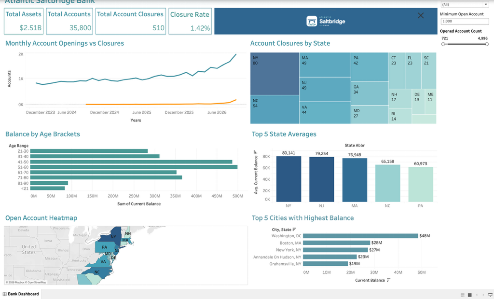

# Atlantic Saltbridge Bank – Executive Dashboard

An interactive Tableau dashboard for a fictional high-yield savings bank, built to answer three questions leadership would ask about a deposit base: **Are we growing? Where are we losing customers? Where is the money concentrated?**

🔗 **[View the live dashboard on Tableau Public](https://public.tableau.com/views/Atlantic_Ridge_Bank/BankDashboard)**



---

## Overview

| | |
|---|---|
| **Tool** | Tableau (Desktop Public Edition / Tableau Public) |
| **Data** | Synthetic bank dataset (Excel), snapshot as of September 30, 2026 |
| **Scope** | 35,800 accounts · $2.51B in deposits · 15 states + DC · Jan 2024 – Sep 2026 |
| **Audience** | Bank executives and managers |

## Key Insights

- **Account growth is accelerating.** January–September openings rose from 7,718 (2024) to 8,970 (2025) to 12,871 (2026), up **43% year over year**. September 2026 was the strongest month on record, with 1,946 new accounts.
- **Closures are accelerating even faster.** Closures went from 6 in 2024 to 75 in 2025 and 429 in 2026. **59% of all closures happened in a single quarter** (Jul–Sep 2026). The overall closure rate is still low at **1.42%**.
- **Deposits are concentrated.** The **top 10% of accounts hold 65% of deposits**, and NY, NJ and MA together hold 38% of all balances.
- **Customers aged 41–60 are the core of the deposit base**, holding about **39%** of balances. Average balance per customer rises steadily with age.
- **Closure rates are consistent across states**, ranging from 1.1% (MD) to 1.8% (RI), so no single market drives attrition.

## Dashboard Features

- **KPI cards:** Total Assets, Total Accounts, Total Account Closures, Closure Rate
- **Monthly Account Openings vs Closures:** trend line over time
- **Account Closures by State:** treemap
- **Balance by Age Brackets:** horizontal bar chart
- **Top 5 State Averages:** average balance per account by state
- **Top 5 Cities with Highest Balance:** labeled as "City, State" so cities with the same name in different states (e.g., Carthage NC and NY) aren't combined
- **Open Account Heatmap:** filled map of open accounts by state
- **Ownership Type:** sole owner vs. joint owner breakdown (separate tab)

**Interactivity**
- Click a state on the map to filter the rest of the dashboard
- Year of Activity filter for the trend chart
- **Minimum Open Accounts** parameter to focus the map on larger markets
- Opened Account Count range slider

## Calculated Fields

| Field | Formula | Purpose |
|---|---|---|
| Closed Accounts Count | `{FIXED [State] : COUNT([CloseDate])}` | Closed accounts per state |
| Opened Account Count | `COUNT([OpenDate])` | Total accounts opened |
| Closed Account Rate | `SUM([Closed Accounts Count]) / [Opened Account Count]` | Closure rate KPI (1.42%) |
| Above Threshold | `[Opened Account Count] >= [Minimum Open Account]` | Drives the map's minimum-accounts filter |
| City, State | `[City] + ", " + [StateAbbr]` | Unique city labels for the Top 5 Cities chart |

**Parameter:** `Minimum Open Account` (default 1,000)

## Data

The workbook uses three tables from one Excel file:

| Table | Grain | Key fields |
|---|---|---|
| **Accounts** | One row per account (35,800) | AccountNumber, CustomerID, Status, OpenDate, CloseDate, CurrentBalance, City, StateAbbr, State, Ownership, FundingStatus |
| **Account_Events** | One row per open/close event (36,310) | AccountNumber, State, StateAbbr, Activity (Opened/Closed), ActivityDate |
| **Table** | Summary by age bracket and ownership type | Age Range, Customers, Current Balance, Customer Share |

> All data is **synthetic**. Atlantic Saltbridge Bank is a fictional bank, and no real customer data is used.

## How to Open

1. Download `Atlantic_Saltbridge_Bank.twbx` from this repository.
2. Open it in [Tableau Desktop Public Edition](https://www.tableau.com/products/public/download) (free) or Tableau Desktop.
3. The data is packaged inside the `.twbx`, so no separate download is needed.

## Repository Structure

```
├── README.md
├── Atlantic_Saltbridge_Bank.twbx   # Tableau packaged workbook (includes data)
└── images/
    └── dashboard.png               # Dashboard screenshot
```

## Author

**Darell Garay** · Junior Data Analyst
[Tableau Public](https://public.tableau.com/app/profile/darell.darell)
